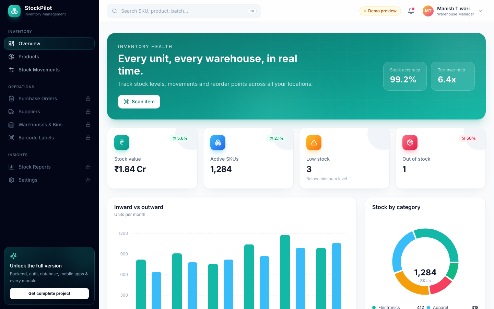
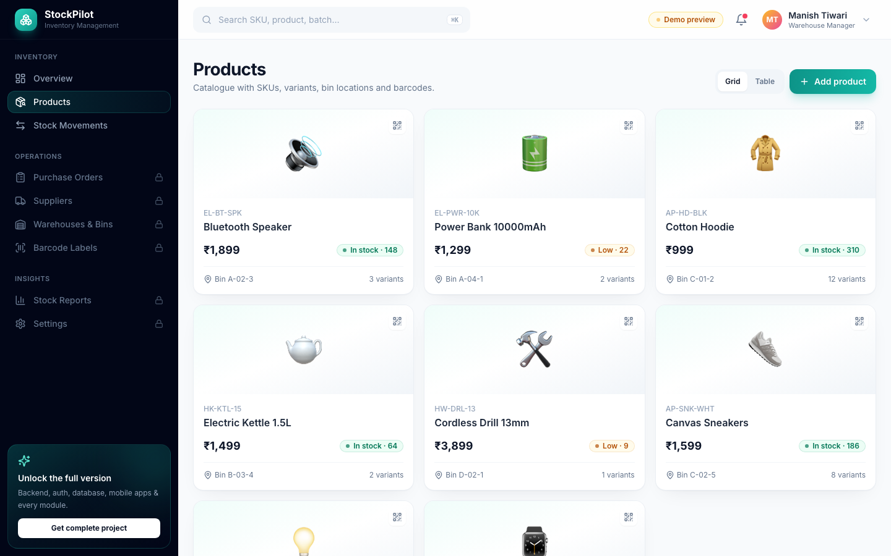
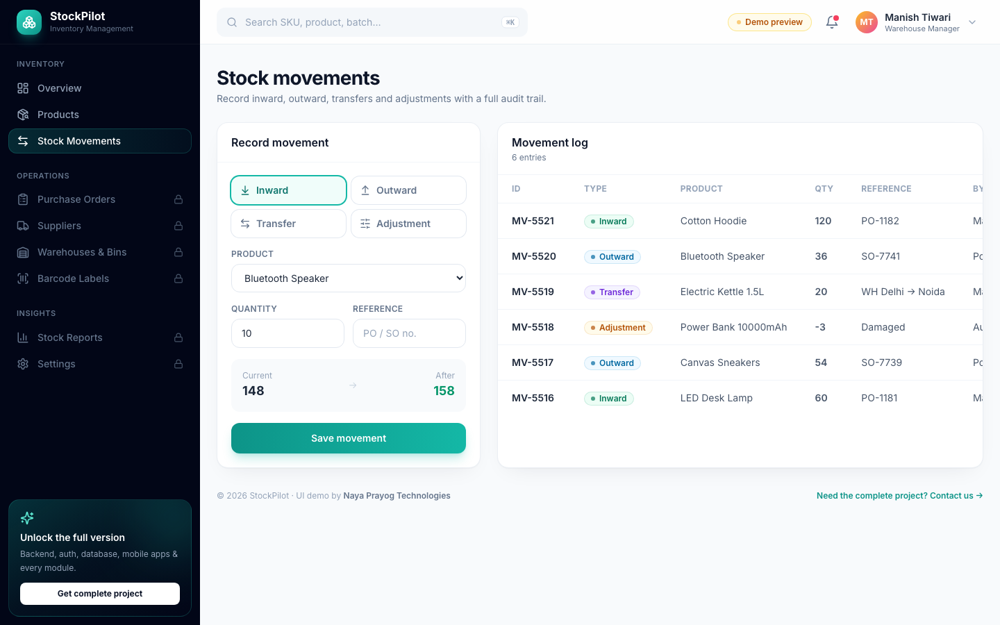

# Inventory Management Software Development | Custom Inventory Solutions

**Custom Inventory Management Software for businesses looking to streamline stock management, track product movement, manage warehouses, control purchases, and improve inventory accuracy.**

Naya Prayog Technologies develops customized inventory management software for retailers, manufacturers, wholesalers, distributors, warehouses, and growing businesses.

Our inventory management solutions help organizations centralize product information, monitor stock levels, manage suppliers, track incoming and outgoing inventory, and make better purchasing decisions.

Whether you need a simple stock management application or an advanced multi-warehouse inventory management system, we can develop a solution tailored to your business operations.

**Website:** https://nayaprayog.com/

---

## What Is Inventory Management Software?

Inventory Management Software is a business application designed to track, organize, and control products, materials, and stock across one or multiple storage locations.

It helps businesses maintain accurate inventory records, monitor stock availability, manage purchases, track stock movement, and reduce manual inventory operations.

A customized inventory management system can help businesses:

- Maintain centralized product records.
- Track stock availability and movement.
- Manage stock-in and stock-out transactions.
- Monitor purchases and supplier information.
- Manage multiple warehouses and locations.
- Identify low-stock products.
- Track inventory valuation.
- Generate inventory and stock reports.

## Inventory Management Software Development Services

Naya Prayog Technologies can develop customized inventory management systems with modules based on your operational requirements.

### 1. Product and Item Management

- Product creation and management
- Product categories and subcategories
- SKU and product code management
- Barcode and QR code support where required
- Product variants and attributes
- Purchase price and selling price
- Product descriptions and images
- Unit and measurement management

### 2. Stock Management

- Stock-in and stock-out management
- Current stock availability
- Stock adjustment
- Stock movement history
- Opening and closing stock records
- Minimum stock levels
- Reorder level configuration
- Low-stock notifications
- Damaged and returned stock records

### 3. Warehouse Management

- Multiple warehouse management
- Warehouse and storage location records
- Warehouse-wise inventory
- Stock transfer between warehouses
- Location-based stock tracking
- Goods receiving and dispatch records
- Warehouse inventory reports

### 4. Purchase and Procurement Management

- Supplier management
- Purchase order creation
- Purchase tracking
- Goods receipt records
- Purchase invoice management
- Supplier payment records
- Purchase history
- Procurement reports

### 5. Supplier and Vendor Management

- Supplier profiles
- Contact information
- Supplier product mapping
- Purchase history
- Supplier payment tracking
- Outstanding balance records
- Vendor performance reports

### 6. Batch and Expiry Management

- Batch number tracking
- Manufacturing date records
- Expiry date tracking
- Batch-wise stock management
- Expiry notifications
- Batch-level stock reports

This functionality is particularly useful for pharmaceuticals, food products, cosmetics, and other businesses dealing with expiry-sensitive inventory.

### 7. Sales and Stock Dispatch Management

- Sales order management
- Product dispatch records
- Stock deduction after sales
- Customer and order records
- Sales return management
- Delivery and dispatch tracking
- Sales-related inventory reports

### 8. Inventory Reports and Analytics

- Current stock reports
- Stock movement reports
- Stock valuation reports
- Low-stock reports
- Purchase reports
- Warehouse-wise inventory reports
- Product-wise movement analysis
- Fast-moving and slow-moving stock analysis
- Inventory adjustment reports

*These are potential capabilities for a customized inventory solution. Final features, integrations, and implementation depend on the agreed project scope.*

## Industries That Need Inventory Management Software

We can develop inventory management solutions for different business models.

### Manufacturing Companies
Track raw materials, components, work-in-progress inventory, and finished goods.

### Wholesale Businesses
Manage bulk stock, supplier purchases, product availability, and warehouse operations.

### Distribution Companies
Monitor product movement, stock transfers, dispatches, and inventory across multiple locations.

### Retail Businesses
Manage product stock, replenishment, purchases, and sales-related inventory updates.

### Warehouses and Logistics
Track incoming goods, outgoing goods, storage locations, and stock transfers.

### Pharmaceutical Businesses
Manage medicines, batches, expiry dates, and inventory records.

### Food and Beverage Businesses
Track stock, batches, expiry-sensitive products, and storage operations.

### E-commerce Businesses
Coordinate product availability, warehouse stock, order processing, and inventory synchronization where integrations are supported.

## Types of Inventory Management Systems We Develop

Depending on your requirements, we can develop:

- Inventory Management Software
- Stock Management Software
- Warehouse Management Systems
- Multi-Warehouse Inventory Software
- Inventory Control Systems
- Manufacturing Inventory Management
- Raw Material Management Software
- Barcode-Based Inventory Systems
- Cloud-Based Inventory Management
- Inventory and Purchase Management Systems
- Inventory ERP Solutions
- Mobile Inventory Management Applications

## Web-Based and Mobile Inventory Management

Our development capabilities can support different platforms.

### Web Administration Dashboard

- Centralized inventory dashboard
- Product and category management
- Supplier and purchase management
- Warehouse management
- Stock movement monitoring
- Inventory reporting

### Mobile Applications

- Product and stock lookup
- Stock-in and stock-out workflows
- Barcode scanning where supported
- Warehouse stock updates
- Inventory verification
- Stock movement records

### Multi-Location Management

- Centralized inventory visibility
- Warehouse-wise stock records
- Location-based user permissions
- Stock transfer workflows
- Consolidated inventory reporting

The final platforms and integrations are determined by the business requirements and technical architecture.

## Why Choose Custom Inventory Management Software?

### Better Stock Visibility
Know what products are available, where they are stored, and how inventory changes over time.

### Reduced Manual Work
Simplify repetitive stock updates, purchase records, and inventory reporting.

### Improved Inventory Accuracy
Maintain structured stock movement records and reduce discrepancies between physical and recorded inventory.

### Better Procurement Decisions
Use stock levels and inventory reports to plan replenishment.

### Multi-Warehouse Control
Manage inventory across multiple warehouses, branches, and storage locations.

### Flexible and Scalable
Start with essential inventory modules and expand the solution as your business grows.

### Business-Specific Workflows
Develop inventory processes according to your product types, units, procurement methods, and operational policies.

## Technology and Development Capabilities

Depending on project requirements, our development capabilities include:

- Frontend: React, Next.js, HTML, CSS, JavaScript
- Backend: Node.js, Python, Django, REST APIs
- Mobile Applications: Flutter for Android and iOS
- Databases: MySQL, PostgreSQL, MongoDB, Firebase
- Integrations: Barcode scanners, compatible hardware, payment services, and third-party APIs
- Cloud and Deployment: VPS and cloud infrastructure
- Analytics: Inventory dashboards and business reporting

The technology stack is selected according to the application's complexity, scalability, security, and performance requirements.

## Our Inventory Software Development Process

1. **Requirement Analysis:** Understand your products, stock operations, warehouses, suppliers, and inventory challenges.
2. **System Planning:** Define inventory modules, database structure, user roles, and stock movement workflows.
3. **UI/UX Design:** Design user-friendly interfaces for administrators, warehouse managers, and employees.
4. **Development:** Develop the required modules and integrate inventory workflows.
5. **Testing:** Validate stock calculations, transactions, transfers, reporting, and permissions.
6. **Deployment:** Deploy the approved application to the agreed hosting or cloud infrastructure.
7. **Maintenance and Enhancements:** Support future improvements according to the project agreement.

## Frequently Asked Questions

### What is the difference between inventory management software and warehouse management software?

Inventory management software focuses on stock records, quantities, purchases, and product movement. Warehouse management software focuses more specifically on warehouse operations, storage locations, receiving, picking, packing, and dispatch. Both can be integrated into one system.

### Can you develop inventory software for multiple warehouses?

Yes. Multi-warehouse functionality can be developed to manage stock across different storage locations, branches, and distribution centers.

### Can inventory software support barcode scanning?

Yes. Barcode scanning can be integrated using compatible scanning devices or supported mobile device cameras, depending on the application architecture.

### Can I track product batches and expiry dates?

Yes. Batch and expiry management can be included for businesses dealing with medicines, food products, cosmetics, and other expiry-sensitive inventory.

### Can inventory management software integrate with billing software?

Yes. Inventory can be integrated with POS, retail billing, ERP, e-commerce, and other business applications through appropriate APIs and shared workflows.

### Can you develop a mobile inventory management application?

Yes. Android and iOS inventory applications can be developed to support stock lookup, scanning, verification, and inventory updates.

### How much does custom inventory management software cost?

Pricing depends on the number of warehouses, product complexity, inventory workflows, integrations, user roles, and required platforms. Contact our team for a customized project estimate.

## Build Your Inventory Management Software with Naya Prayog Technologies

Still managing stock through spreadsheets, manual registers, or disconnected applications?

Naya Prayog Technologies can help you develop a customized inventory management system to improve stock visibility, simplify warehouse operations, and streamline inventory control.

**Contact Our Team**

- Website: https://nayaprayog.com/
- Email: [support@nayaprayog.com](mailto:support@nayaprayog.com)
- Phone / WhatsApp: +91 7991327022
- WhatsApp Enquiry: https://wa.me/917991327022
- Portfolio: https://github.helloharendra.io

**Tell us about your inventory requirements and let's discuss your software project.**

---

## Repository Information

This repository represents the inventory management software development services and solution capabilities of Naya Prayog Technologies.

It is intended as a project and service showcase. It does not grant permission to redistribute, commercially use, or reproduce proprietary source code, designs, or intellectual property.

For licensing or commercial enquiries, contact Naya Prayog Technologies.

<!-- screenshots -->
## Screenshots

**Dashboard**

<table>
  <tr>
    <td align="center" width="50%"><b>Products</b>  </td>
    <td align="center" width="50%"><b>Movements</b>  </td>
  </tr>
</table>
